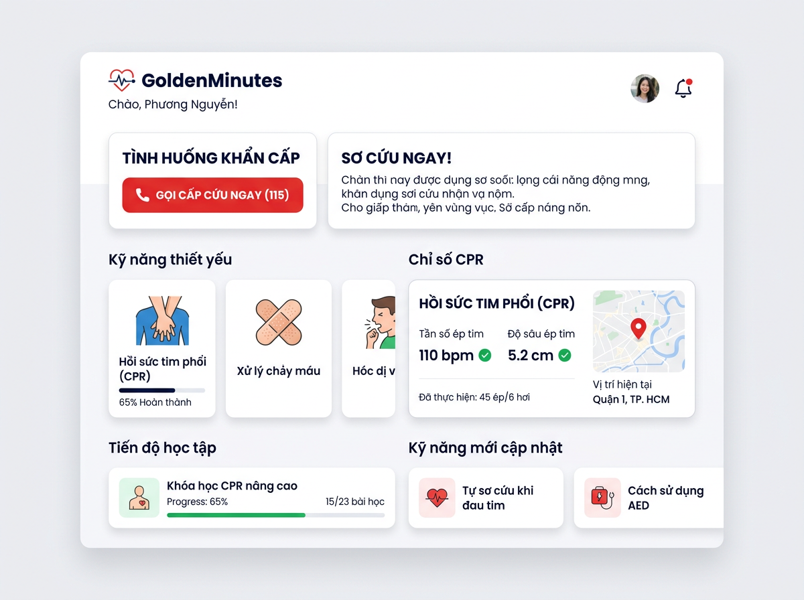
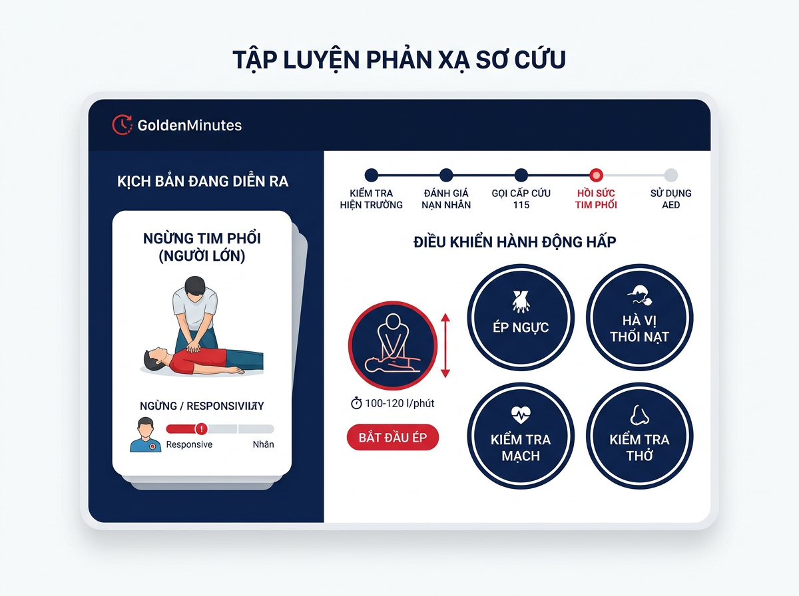
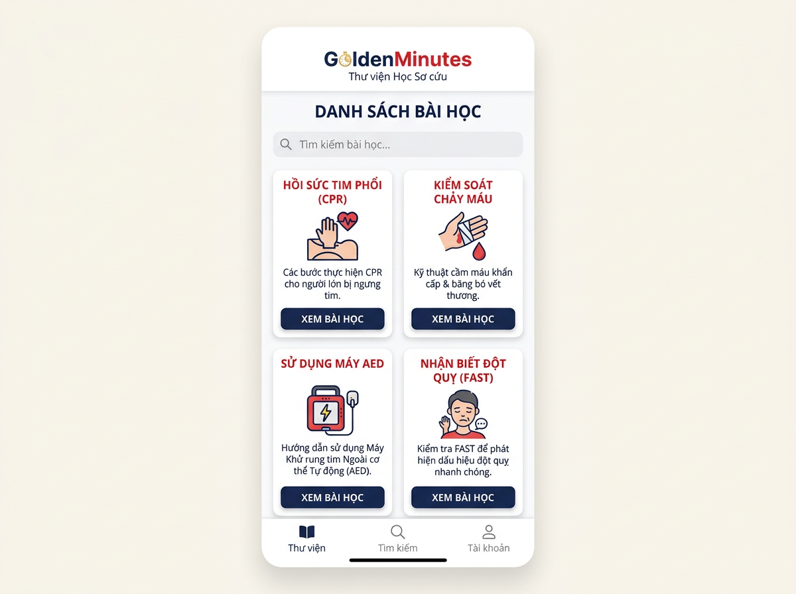
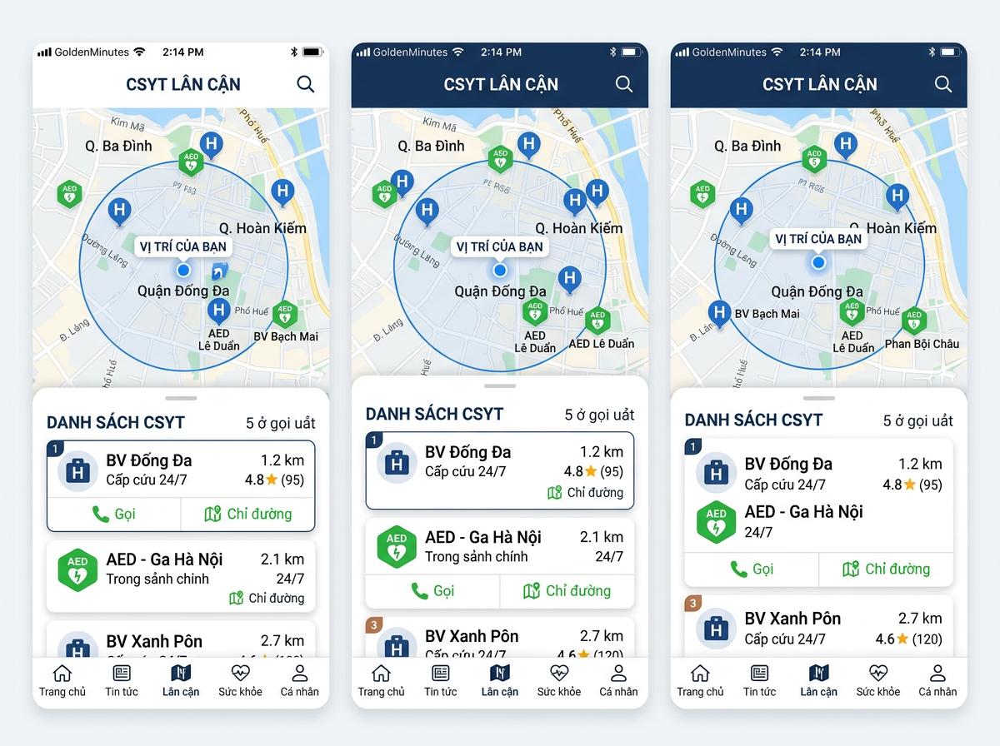
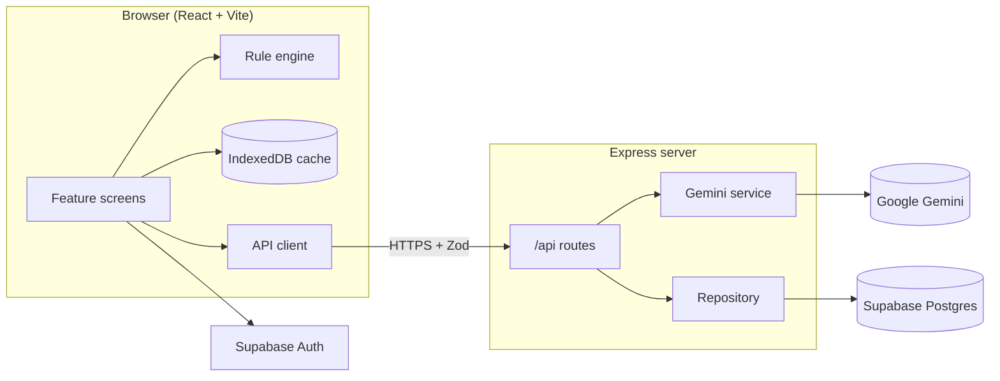

<div align="center">

<h1>GoldenMinutes</h1>

<p><strong>Reflex training and first-aid guidance for the first minutes of a cardiac emergency.</strong></p>

<p>
  <a href="#getting-started">Getting started</a> ·
  <a href="#features">Features</a> ·
  <a href="#architecture">Architecture</a> ·
  <a href="#api-reference">API</a> ·
  <a href="#contributing">Contributing</a>
</p>

<p>
  
  
  
  
  
  
  
  
</p>

<table>
  <tr>
    <td></td>
    <td></td>
    <td></td>
    <td></td>
  </tr>
  <tr>
    <td align="center"><sub>Home</sub></td>
    <td align="center"><sub>Training</sub></td>
    <td align="center"><sub>Library</sub></td>
    <td align="center"><sub>Nearby care</sub></td>
  </tr>
</table>

</div>

---

## About

In an out-of-hospital cardiac arrest, every minute without chest compressions lowers the chance of survival by roughly 7 to 10 percent. Most bystanders know they should act, but hesitate because they are unsure of the steps.

GoldenMinutes was built for AISC 2026 to close that gap. People rehearse short, realistic scenarios on their phone, get scored against the AHA 2020 CPR guidelines, and can switch to a guided real-emergency mode when it matters. The interface is in Vietnamese and is designed mobile-first.

> [!WARNING]
> GoldenMinutes is an educational tool. It does not replace certified first-aid training or professional medical care. In a real emergency in Vietnam, call **115** first.

## Features

| Area | What it does |
| --- | --- |
| **Real emergency mode** | Step-by-step guidance with a 110 bpm compression metronome and a one-tap 115 call. |
| **Reflex drills** | Three-minute scenarios (OHCA, bleeding, stroke, AED use) that measure response time and decision order. |
| **Voice and camera input** | Describe the scene by voice or photo. Gemini extracts the clinical facts and the rule engine checks them. |
| **Results and metrics** | Avoidable Delay Index (ADI), per-step timing, and personalised feedback after each session. |
| **Nearby care** | Map of hospitals and public AED locations. Falls back to an offline directory when no Maps key is set. |
| **Learning library** | Curated lessons on CPR, bleeding control, AED access, and the FAST stroke check. |
| **Offline-friendly** | Sessions are cached in IndexedDB and synced once the connection returns. |

## Tech stack

- **Client:** React 19, TypeScript, Vite 6, Tailwind CSS 4, React Router 7, TanStack Query, Motion, Recharts, Leaflet
- **Server:** Express 4 with Zod validation, bundled with esbuild for production
- **AI:** Google Gemini through `@google/genai`, called only from the server
- **Data and auth:** Supabase Auth, Postgres, Row Level Security, and curated knowledge/training datasets
- **Testing:** Vitest

## Getting started

### Prerequisites

- Node.js 20 or newer
- A [Gemini API key](https://aistudio.google.com/apikey)
- A Supabase project (required for sign-in, profiles, cloud sync, and knowledge retrieval)

### Installation

```bash
git clone https://github.com/baodangerous/aisc2026.git
cd aisc2026
npm install
cp .env.example .env.local
```

Fill in `.env.local` (see [Configuration](#configuration)), then start the dev server:

```bash
npm run dev
```

The app runs at [http://localhost:3000](http://localhost:3000).

### Scripts

| Command | Description |
| --- | --- |
| `npm run dev` | Start the Vite dev server on port 3000 |
| `npm run build` | Build the client and bundle the server into `dist/` |
| `npm start` | Run the production server from `dist/server.js` |
| `npm run lint` | Type-check the project with `tsc --noEmit` |
| `npm test` | Run the Vitest suite |

## Configuration

| Variable | Required | Description |
| --- | :---: | --- |
| `GEMINI_API_KEY` | Yes | Server-side key for Gemini requests |
| `GEMINI_MODEL` | No | Model override. Defaults to `gemini-3.7-flash` |
| `APP_URL` | No | Public URL of the deployment, used for callbacks |
| `PORT` | No | Production server port |
| `CORS_ORIGIN` | No | Comma-separated list of allowed origins |
| `VITE_GOOGLE_MAPS_API_KEY` | No | Enables Google Maps and Places search on the Nearby screen |
| `VITE_SUPABASE_URL` | Yes | Supabase project URL |
| `VITE_SUPABASE_ANON_KEY` | Yes | Supabase publishable/anonymous key |
| `SUPABASE_URL` | Yes | Server-side Supabase URL |
| `SUPABASE_SERVICE_ROLE_KEY` | Yes | Server-only key for ingestion and protected jobs |

Variables prefixed with `VITE_` are exposed to the browser. Never put secrets in them.

## Architecture



```text
.
├── server/                 Express app, API routes, Gemini and Supabase services
├── src/
│   ├── components/         Shared UI (navigation, sheets, buttons)
│   ├── content/            Approved scenarios and the learning catalogue
│   ├── domain/             Rule engine, metric calculators, Zod schemas
│   ├── features/           auth, emergency, home, library, nearby, training
│   └── services/           API client, Supabase, IndexedDB, voice input
├── server/                 Express routes, Supabase auth, AI retrieval and APIs
├── data/                   Curated sources and JSONL training dataset
├── scripts/                Validated ingest and quality pipeline
├── supabase/               Migrations and seed assets
├── tests/                  Vitest suites for API, security, and resilience
└── public/                 Static assets and the web app manifest
```

Scenario content in `src/content` is reviewed by hand. Gemini only extracts facts from what the user says or shows. All scoring and safety decisions are made by the deterministic rule engine in `src/domain`.

## API reference

All endpoints are served under `/api` and return JSON.

| Method | Endpoint | Purpose |
| --- | --- | --- |
| `GET` | `/health` | Service status and active model |
| `GET` | `/scenarios`, `/scenarios/:id` | List or fetch training scenarios |
| `POST` | `/sessions` | Start a training session |
| `POST` | `/sessions/:id/events` | Record a step within a session |
| `POST` | `/sessions/:id/complete` | Finish a session and compute metrics |
| `GET` | `/sessions`, `/sessions/:id` | Session history for the signed-in user |
| `GET` | `/facilities` | Nearby hospitals and AED locations |
| `POST` | `/ai/extract-facts` | Extract scene facts from text |
| `POST` | `/ai/transcribe-audio` | Transcribe a voice description |
| `POST` | `/ai/extract-visual-facts` | Extract scene facts from a photo |
| `POST` | `/ai/insights` | Personalised feedback for a finished session |
| `POST` | `/auth/sync-profile` | Create or update the user profile |
| `POST` | `/privacy/delete-request` | Request deletion of personal data |

Liveness and readiness probes are available at `/healthz` and `/readyz`.

## Testing

```bash
npm test
```

The suite covers API routing and content types, CORS policy, role escalation, session idempotency, Gemini failure handling, safety claims in generated text, and the production entry point.

## Medical references

- American Heart Association, *Guidelines for CPR and Emergency Cardiovascular Care*, 2020
- Government of Vietnam, Decree 279/2025/NĐ-CP
- Stop the Bleed and FAST stroke recognition protocols

## Contributing

1. Fork the repository and create a branch from `main`.
2. Keep changes focused and add tests where behaviour changes.
3. Run `npm run lint` and `npm test` before opening a pull request.
4. Any change to medical content in `src/content` must cite its source in the pull request description.

## License

No license has been chosen yet. Until one is added, all rights are reserved by the project authors.
