# Sơ Đồ Thực Thể Quan Hệ (ERD) — GoldenMinutes AISC'26

Tài liệu thiết kế kiến trúc cơ sở dữ liệu quan hệ lõi cho nền tảng GoldenMinutes (Golden Pulse — Data Driven Business).

---

## 1. Sơ Đồ Quan Hệ Mermaid (ERD)

```mermaid
erDiagram
    %% Core Entities & Users
    USERS ||--o{ USER_PROFILES : "has"
    USERS ||--o{ ORGANIZATION_MEMBERS : "member of"
    USERS ||--o{ RESOURCE_SUBMISSIONS : "submits"
    USERS ||--o{ DIGITAL_PROOFS : "owns"
    USERS ||--o{ RESPONDERS : "operates as"

    ORGANIZATIONS ||--o{ ORGANIZATION_MEMBERS : "employs"
    ORGANIZATIONS ||--o{ SITES : "manages"
    ORGANIZATIONS ||--o{ EMERGENCY_RESOURCES : "maintains"
    ORGANIZATIONS ||--o{ INTERVENTIONS : "executes"
    ORGANIZATIONS ||--o{ INCIDENTS : "monitors"
    ORGANIZATIONS ||--o{ DATA_PARTNERSHIPS : "contracts"

    SITES ||--o{ SITE_SUBSCRIPTIONS : "subscribed to"
    SITES ||--o{ EMERGENCY_RESOURCES : "hosts"
    SITES ||--o{ INTERVENTIONS : "target site"

    %% Resources & Verification
    EMERGENCY_RESOURCES ||--o{ RESOURCE_VERIFICATIONS : "history"
    EMERGENCY_RESOURCES ||--o{ RESOURCE_CHANGE_HISTORY : "audits"
    RESOURCE_SUBMISSIONS ||--o| EMERGENCY_RESOURCES : "approved into"

    %% Incidents, Timeline & ADI
    INCIDENTS ||--o{ INCIDENT_TIMELINE_EVENTS : "contains"
    INCIDENTS ||--o{ RESPONDER_ALERTS : "triggers"
    INCIDENTS ||--o| DIGITAL_PROOFS : "certified by"
    REGIONS ||--o{ INCIDENTS : "located in"
    DELAY_THRESHOLDS ||--o{ INCIDENTS : "evaluates ADI"

    %% Responders
    RESPONDERS ||--o{ RESPONDER_ALERTS : "receives"

    %% Decision -> Action -> Measure Closed Loop
    INTERVENTIONS ||--o{ INTERVENTION_EVALUATIONS : "measured by"
    METRIC_DEFINITIONS ||--o{ INTERVENTION_EVALUATIONS : "standardized by"

    %% Pilot Real Data & Surveys
    INCIDENTS ||--o{ PILOT_SURVEYS : "assessed with"

    %% Auditing
    USERS ||--o{ AUDIT_LOGS : "performed by"

    USERS {
        uuid id PK
        string email
        timestamptz created_at
    }

    USER_PROFILES {
        uuid id PK,FK
        string role "citizen|volunteer|moderator|org_admin|platform_admin"
        string display_name
        string phone
        string geohash6
        boolean is_active
    }

    ORGANIZATIONS {
        uuid id PK
        string name
        string organization_type "enterprise|school|healthcare|government"
        string plan "pilot|pro|enterprise"
        string status "active|trial|suspended"
        uuid created_by FK
    }

    SITES {
        uuid id PK
        uuid organization_id FK
        string name
        string site_type "office|school|factory|public_area"
        string address
        string province
        string status
    }

    EMERGENCY_RESOURCES {
        uuid id PK
        string resource_type "aed|first_aid_kit|emergency_cabinet|bleeding_control_kit"
        string name
        string address
        float lat
        float lng
        string geohash7
        uuid site_id FK
        uuid managing_org_id FK
        string source "osm|admin|org_submission|synthetic"
        string origin "training_user|synthetic_seed|pilot_verified|osm_import"
        string verification_status "unverified|pending|verified|rejected|expired"
        timestamptz verified_at
        timestamptz expires_at
        timestamptz last_checked_at
    }

    RESOURCE_SUBMISSIONS {
        uuid id PK
        uuid submitted_by FK
        string resource_type
        string name
        string address
        float lat
        float lng
        string evidence_url
        string managing_org_name
        string status "pending|approved|rejected"
        string rejection_reason
    }

    INCIDENTS {
        uuid id PK
        uuid organization_id FK
        string region_cell FK
        string severity "critical|emergency|urgent|non_urgent"
        string scenario_id
        string status "open|in_progress|resolved|cancelled"
        string origin "training_user|synthetic_seed|pilot_verified"
        boolean consent_to_analytics
        timestamptz occurred_at
    }

    INCIDENT_TIMELINE_EVENTS {
        uuid id PK
        uuid incident_id FK
        string client_event_id "UNIQUE idempotency"
        string event_type "recognized|guidance_opened|called_115|first_action|responder_arrived"
        timestamptz occurred_at
        jsonb metadata
    }

    DELAY_THRESHOLDS {
        string scenario_category PK "cardiac_arrest|stroke|severe_bleeding|choking"
        string title_vi
        int time_to_guidance_sec
        int time_to_call_sec
        int time_to_action_sec
        int mro_threshold_sec
        string source_reference
    }

    METRIC_DEFINITIONS {
        string key PK "adi_sec|mro_rate|time_to_guidance_sec|time_to_call_sec"
        string name_vi
        string formula_text
        string limitation_text
        string version
    }

    REGIONS {
        string region_id PK "Q1-P01|Q3-P05|..."
        string name
        string province
        string district
        string area_type "residential|commercial|industrial|educational|mixed"
        float lat
        float lng
        text[] geohash6_list
    }

    RESPONDERS {
        uuid id PK
        uuid user_id FK
        string certification_level "medical|cpr_certified|internal_trained"
        boolean verified
        boolean available
        string last_geohash7
        string origin
    }

    RESPONDER_ALERTS {
        uuid id PK
        uuid incident_id FK
        uuid responder_id FK
        int tier
        timestamptz sent_at
        string outcome "pending|accepted|declined|timeout"
    }

    INTERVENTIONS {
        uuid id PK
        uuid organization_id FK
        uuid site_id FK
        string region_id FK
        string type "cpr_training|aed_verification|process_change|community_campaign"
        string title
        timestamptz started_at
        timestamptz ended_at
    }

    INTERVENTION_EVALUATIONS {
        uuid id PK
        uuid intervention_id FK
        string metric_key FK
        string window_before
        string window_after
        float value_before
        float value_after
        int n_before
        int n_after
        jsonb origin_breakdown
    }

    DIGITAL_PROOFS {
        uuid id PK
        string incident_id
        string user_id
        jsonb summary
        string payload_hash "UNIQUE SHA256"
        jsonb consent_snapshot
        string legal_disclaimer
        timestamptz created_at
    }

    PILOT_SURVEYS {
        uuid id PK
        string session_id
        string device_hash
        string survey_type "pre|post"
        int confidence_score "1-5"
        int preparedness_score "1-5"
        int anxiety_score "1-5"
        jsonb sus_scores
        float sus_final_score "0-100"
        boolean consent
    }

    AUDIT_LOGS {
        uuid id PK
        string actor_id
        string action "CREATE|UPDATE|DELETE|ROLE_CHANGE|REVIEW_SUBMISSION"
        string entity_type
        string entity_id
        jsonb metadata
        timestamptz created_at
    }
```

---

## 2. Từ Điển Dữ Liệu & Quy Chuẩn Phân Loại Nguồn (Origin)

Mọi bản ghi đo lường (incidents, responders, metrics, emergency_resources) đều bắt buộc mang thuộc tính `origin` để phân lập rõ ràng:
1. `training_user`: Phiên thực hành của học viên thật trên ứng dụng web/di động.
2. `pilot_verified`: Phiên thử nghiệm kiểm chứng thực tế có giám sát chuyên gia hoặc thiết bị AED kiểm tra trực tiếp.
3. `osm_import`: Dữ liệu hạ tầng mở từ OpenStreetMap (chỉ để tham khảo, mặc định `unverified`).
4. `synthetic_seed`: Dữ liệu mô phỏng theo phân phối xác suất khoa học dùng minh họa luồng phân tích (tuyệt đối không xuất hiện trên bản đồ người dùng công cộng).
